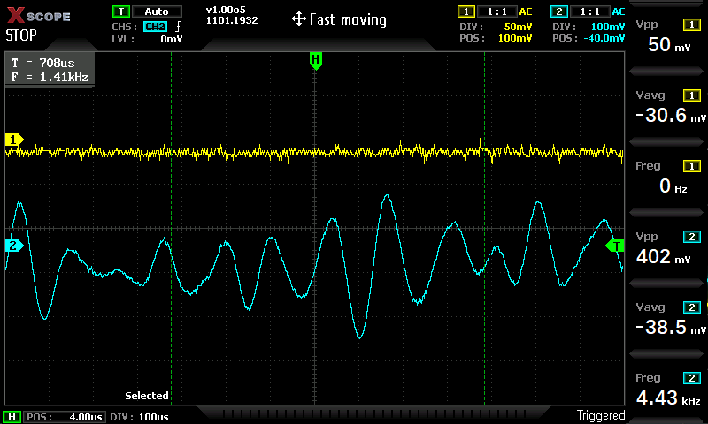
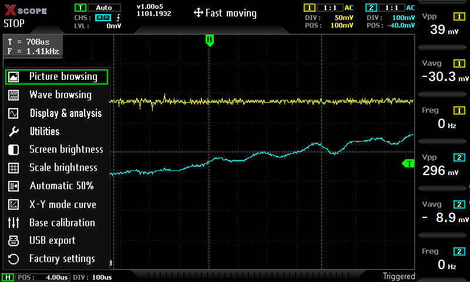
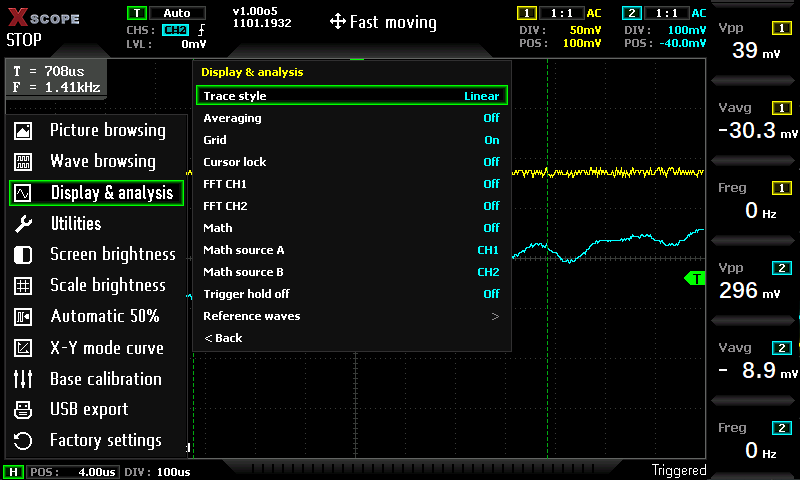
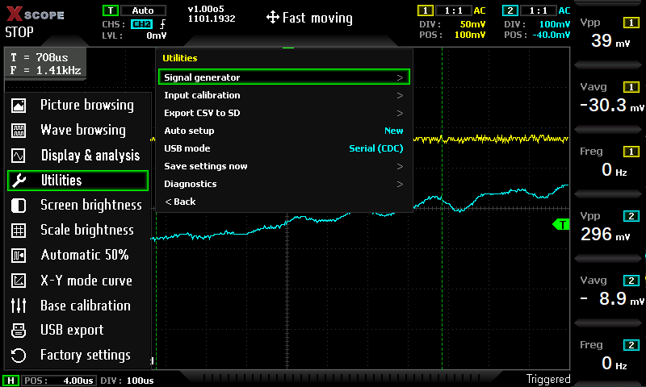
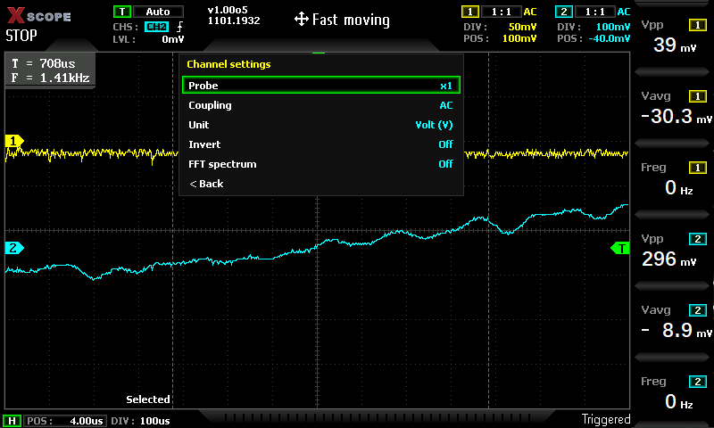
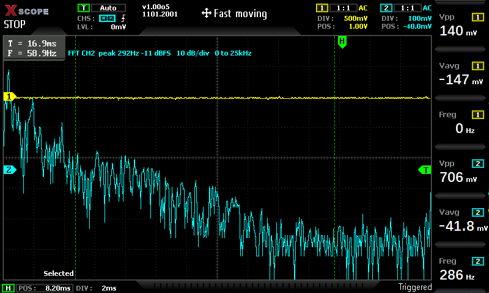
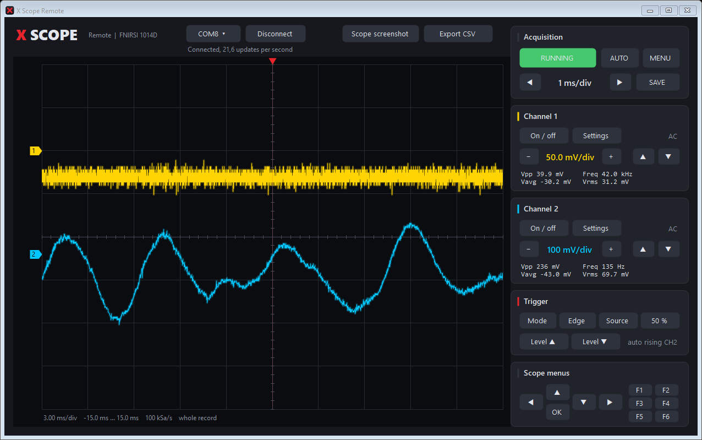

# X Scope

Open firmware for FNIRSI oscilloscopes, with a Windows application for live view and control
over USB.



*Screenshots are taken from the scope itself over USB, with music from an audio interface on
channel 2.*

## Highlights

- Runs from the internal SD card, the original firmware stays in the SPI flash and remains one
  key press away
- About 40 screen updates per second thanks to the enabled data cache, menus and knobs respond
  right away
- FFT, math, reference waveforms, averaging, sin(x)/x and more, all reachable from the front
  panel keys
- [X Scope Remote](X%20Scope%20-%20Application): both channels live on the PC, every key, CSV
  export and screenshots over a plain USB cable
- Windows installer with a window: select the scope, press Install

## Folders

| Folder | Contents |
|---|---|
| [`FNIRSI-1014D/firmware`](FNIRSI-1014D/firmware) | Scope firmware source |
| [`FNIRSI-1014D/loader`](FNIRSI-1014D/loader) | SD card loader source. Hold a key at power on: F1 X Scope, F2 original firmware, F3 FEL (USB) mode |
| [`FNIRSI-1014D/tools`](FNIRSI-1014D/tools) | SD card image packer |
| [`FNIRSI-1014D/installer`](FNIRSI-1014D/installer) | Windows installer source |
| [`X Scope - Application`](X%20Scope%20-%20Application) | X Scope Remote, the Windows application for live view and control over USB |

## FNIRSI-1014D

Firmware for the FNIRSI 1014D benchtop oscilloscope (Allwinner F1C100s, stock FPGA 0x1432).

### Menus

| Main menu | Display & analysis |
|---|---|
|  |  |
| **Utilities** | **Channel settings** |
|  |  |

### FFT



The spectrum of channel 2 (1024 points, Hann window, 10 dB per division), drawn in place of its
time trace. The frequency span follows the time base.

### Features

- **Acquisition:** two channels, auto / normal / single trigger, roll mode down to 50 s/div
- **Measurements:** six slots on F1 to F6, time and voltage cursors with optional cursor lock
- **Channel menu:** probe x0.5 to x1000, DC/AC, volt or ampere, invert, FFT
- **Display & analysis:** trace styles (linear, dots, peak, pro, sin(x)/x), averaging, grid on/off,
  FFT per channel, math (A+B, A-B, AxB, A/B), software trigger hold off, eight reference
  waveforms
- **Utilities:** input (gain) calibration, CSV export to the SD card, USB mode (serial or mass
  storage), auto setup old/new, diagnostics with live timing
- **More:** base (zero) calibration, X-Y mode, picture and waveform save and browse, USB disk
  access
- **Speed:** data cache enabled (MMU, write-through), about 40 screen updates per second

The signal generator menu is present, but the stock FPGA has no known generator command, so it
produces no output on the stock FPGA.

## X Scope Remote



The scope starts in USB serial mode, so the application connects as soon as the cable is in.
Both channels are drawn from the raw samples, with zoom and pan, measurements per channel,
every front panel key, a pixel exact screenshot of the scope and CSV export.
See [X Scope - Application](X%20Scope%20-%20Application) for use, build and the command list.

## Install on Windows

1. Download `X-Scope-Installer.exe` from the releases page.
2. Connect the scope by USB and open its USB disk mode:
   - original firmware: the USB connection option of its menu
   - X Scope: Utilities, USB mode, Mass storage, then MENU, USB export
3. Start the installer (it asks for administrator rights), select the scope and press Install.

On the first install the card is repartitioned (its partition must start at 1 MiB), which erases
the files on the card; the installer offers a full backup of the card first. Later updates keep
the partition, files and settings. After writing, leave the USB mode (in the original firmware
switch the scope off with the power button), then switch the scope off and on.

To go back to the original firmware, hold a key at power on and choose F2, or restore the backup.

## Build

Needs the GNU Arm toolchain (`arm-none-eabi-gcc`), GNU make and Python 3:

```
cd FNIRSI-1014D
make
```

`build/x-scope-1014d.bin` is the SD card image (written at 8 KiB), `build/x-scope-1014d-ram.bin`
the firmware alone for loading over USB in FEL mode. The installer is built on Windows with
`installer\build.cmd` after `make`, the application with `build.cmd` in its folder.

## Contributors

**[Marcel Balk](https://github.com/Marcel-Balk)** (2026), X Scope for the FNIRSI 1014D:

- Port to the 1014D front panel: every function reachable from the keys and knobs, with the
  Display & analysis, Utilities, Channel, Reference waves and Diagnostics menus
- FFT, math, sin(x)/x, averaging, reference waveforms, trigger hold off, cursor lock, input
  (gain) calibration and CSV export
- Data cache (MMU, write-through): screen updates from about 10 to about 40 per second, menus and
  knobs without lag
- X Scope logo, start screen and main menu icons
- USB remote control: command protocol, serial mode at start, X Scope Remote for Windows
- USB fixes: transmit FIFO address, transmit timeout, screen turning white while a PC polls
- Time base and V/div changed while stopped now apply when acquisition starts again, FFT readout
  placed next to the T/F box
- Windows installer, SD card image packer and build files

## License

GPLv3, see [LICENSE](LICENSE). X Scope is a modified version (2026, Marcel Balk) of GPLv3
licensed open firmware for FNIRSI oscilloscopes. FatFs is copyright ChaN under its own license, included in
the source files.
