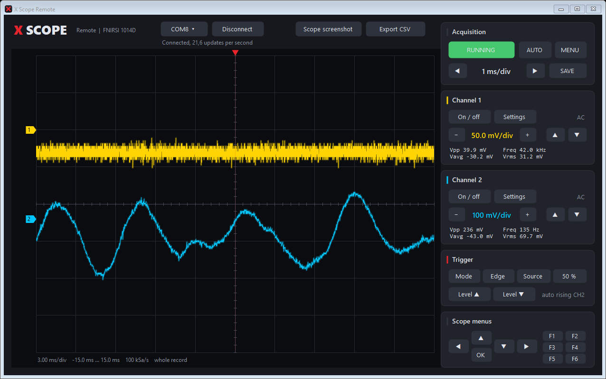
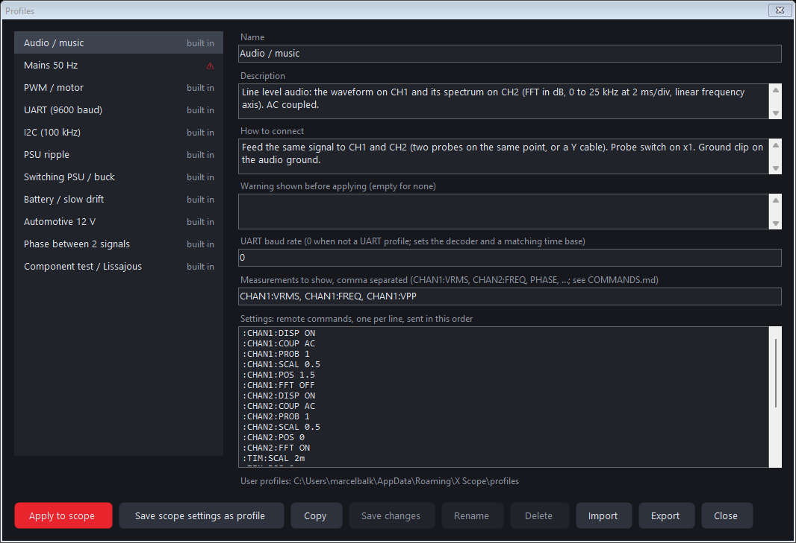

# X Scope Remote

Windows application for live view and control of a FNIRSI 1014D running X Scope, over USB.



- Both channels drawn live from the raw samples of the scope, with the scope's grid, colors,
  zero markers and trigger point
- Mouse wheel over the graph zooms the time axis, dragging pans, double click shows the whole record
- Vpp, Vavg, Vrms and frequency per channel, computed on the PC
- Every front panel key: run/stop, auto, menu, time base, V/div, position, trigger, menu
  navigation and F1 to F6. Keyboard: arrows, Enter (OK), Esc (MENU), Space (RUN/STOP)
- Scope screenshot (pixel exact PNG of the scope screen) and CSV export of both channels in volts
- Profiles that set the scope up for a task in one step, with their measurements shown under the
  graph

## Profiles



A profile holds:
- the scope settings, as remote commands (see [COMMANDS.md](../COMMANDS.md))
- the measurements to show
- a note on how to connect the probes
- an optional warning

**Apply to scope** sends every setting, reads each one back and lists the result. A setting the
scope refused or reports differently is shown in red. The profile's measurements are then shown
under the graph and placed in the scope's F1 to F6 slots and its extra measurement panel.

Built-in profiles:

| Profile | Setup |
|---|---|
| Audio / music | AC, 2 ms/div, waveform on CH1 and spectrum (FFT in dB, 0 to 25 kHz) on CH2, Vrms and frequency |
| Mains 50 Hz | x10, 50 V/div, 5 ms/div, Vrms and frequency. Shows a safety warning that must be confirmed |
| PWM / motor | x10, 50 us/div, duty cycle, frequency, rise time |
| UART (9600 baud) | Single shot on the falling edge, time base from the baud rate, UART decoding on |
| I2C (100 kHz) | CH1 SDA, CH2 SCL, single shot on the start, I2C decoding on |
| PSU ripple | AC, 50 mV/div, Vpp with statistics over 100 captures |
| Switching PSU / buck | x10, 1 us/div, normal trigger, frequency, duty, rise time, overshoot |
| Battery / slow drift | Roll mode at 5 s/div |
| Automotive 12 V | x10, DC, 10 ms/div, Vavg, Vmax, Vmin, Vpp |
| Phase between 2 signals | Both channels, phase and delay CH1 to CH2 |
| Component test / Lissajous | X-Y mode |

**Save scope settings as profile** reads the current setup from the scope (`SYSTem:SETup?`) and
stores it as a new profile. Your own profiles can be edited, renamed, deleted, imported and
exported. They are JSON files in `%APPDATA%\X Scope\profiles`. Built-in profiles are read only;
**Copy** makes an editable copy.

**Mains:** never measure mains against the scope ground while the scope is connected to a PC by
USB. The probe ground is connected to the PC through the USB cable. Use only an isolated or
differential probe.

## Use

`X-Scope-Setup.exe` from the releases page installs the application (Start menu, desktop
shortcut, removal through Windows' installed apps list) together with the scope firmware.

1. Connect the scope by USB. X Scope starts in USB serial mode, so it shows up as a COM port.
2. Start `X-Scope-Remote.exe`, choose the port and press Connect.

For access to the SD card, switch the scope to mass storage in Utilities, USB mode, then MENU,
USB export. The scope returns to serial mode at the next start.

## Build

Needs only Windows (the .NET Framework 4.x C# compiler that ships with it):

```
build.cmd
```

## Protocol

Plain text lines over the USB serial port; every reply ends with `#END`. The scope understands
the original commands below and a SCPI style command set for every setting, measurement,
statistic and decoder: see [COMMANDS.md](../COMMANDS.md).

| Command | Reply |
|---|---|
| `IDN?` | Name and version |
| `STATUS?` | Run state, time base, sample rate, channel and trigger settings |
| `KEYS?` / `KEY <name>` | List of key names / press a key |
| `WAVEB? <1\|2>` | Header line with the scaling, then the raw 8 bit samples |
| `WAVE? <1\|2>` | The samples in millivolts as text |
| `SCREEN? <row> <rows>` | Up to 16 rows of the screen as RGB565 |
