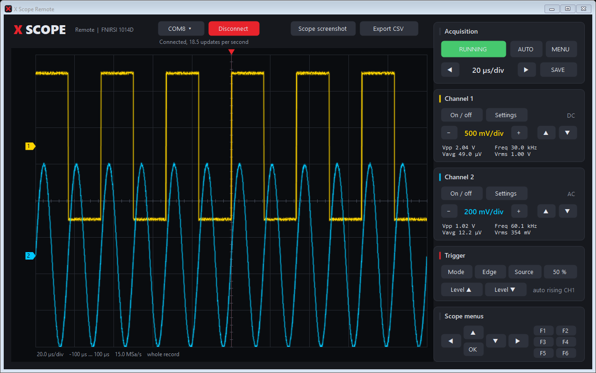

# X Scope Remote

Windows application for live view and control of a FNIRSI 1014D running X Scope, over USB.



- Both channels drawn live from the raw samples of the scope, with the scope's grid, colors,
  zero markers and trigger point
- Mouse wheel over the graph zooms the time axis, dragging pans, double click shows the whole record
- Vpp, Vavg, Vrms and frequency per channel, computed on the PC
- Every front panel key: run/stop, auto, menu, time base, V/div, position, trigger, menu
  navigation and F1 to F6. Keyboard: arrows, Enter (OK), Esc (MENU), Space (RUN/STOP)
- Scope screenshot (pixel exact PNG of the scope screen) and CSV export of both channels in volts

## Use

1. Connect the scope by USB. X Scope starts in USB serial mode, so it shows up as a COM port.
2. Start `X-Scope-Remote.exe`, choose the port and press Connect.

For access to the SD card, switch the scope to mass storage in Utilities, USB mode, then MENU,
USB export. The scope returns to serial mode at the next start.

## Build

Needs only Windows (the .NET Framework 4.x C# compiler that ships with it):

```
build.cmd
```

## Protocol

Plain text lines over the USB serial port; every reply ends with `#END`.

| Command | Reply |
|---|---|
| `IDN?` | Name and version |
| `STATUS?` | Run state, time base, sample rate, channel and trigger settings |
| `KEYS?` / `KEY <name>` | List of key names / press a key |
| `WAVEB? <1\|2>` | Header line with the scaling, then the raw 8 bit samples |
| `WAVE? <1\|2>` | The samples in millivolts as text |
| `SCREEN? <row> <rows>` | Up to 16 rows of the screen as RGB565 |
